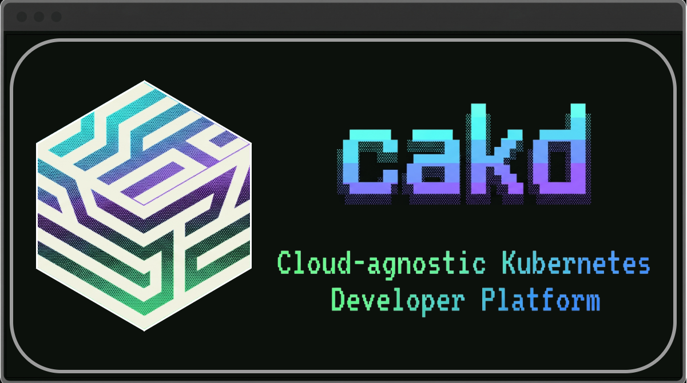

# CAKD — Cloud Application Kubernetes Deployment Platform

A developer-centric CLI, interactive TUI wizard, Model Context Protocol (MCP) server, and in-cluster AI observability agent that scaffolds, provisions, deploys, and diagnoses cloud-native applications — built in **Go 1.27** with a strict **Hexagonal Architecture (Ports & Adapters)**.

---

<div align="center">
  
</div>

---

## Core Capabilities

- **Hexagonal Architecture (Ports & Adapters)** — Pure domain and application use cases decoupled from terminal I/O and infrastructure adapters, continuously verified by an automated Go AST boundary test (`internal/platform/architecture_test.go`).
- **Three Driving Surfaces**:
  - **CLI (`cakd-cli`)** — Full command suite (`validate`, `init`, `create`, `observe`, `auth`, `schema`, `ui`, `mcp`, `version`) with `--json` output mode.
  - **Interactive TUI Wizard (`cakd-cli ui` / `cakd-cli create -i`)** — Step-by-step guided project creation without writing YAML manually.
  - **MCP Server (`cakd-cli mcp` / `cakd-mcp`)** — Stdio and Streamable HTTP (`POST /mcp`) Model Context Protocol server exposing 2 MCP Resources and 7 MCP Tools for AI coding agents.
- **Canonical `cakd.io/v1alpha1` Schema** — Unified Kubernetes-style `spec:` block (`spec.cluster`, `spec.providers`, `spec.observability`, `spec.backing`, `spec.services`) with backward-compatible normalization for legacy `platform.dev/v1alpha1` files and Draft 2020-12 JSON Schema (`schemas/platform.schema.json`).
- **Isolated Terraform State** — Separate state directories for cluster provisioning (`.platform/terraform/cluster/`) and VCS repository provisioning (`.platform/terraform/vcs/`).
- **In-Cluster AI Diagnostics (`cakd-agent`)** — Receives Alertmanager webhooks, routes alerts per namespace to Discord channels, and runs Google Gemini root-cause analysis on Prometheus metrics and Loki logs.

---

## Binaries

| Binary | Path | Purpose |
| :--- | :--- | :--- |
| **`cakd-cli`** | `./cmd/cakd-cli` | Developer CLI, Interactive TUI Wizard (`cakd-cli ui`), and embedded MCP Server (`cakd-cli mcp`) |
| **`cakd-agent`** | `./cmd/cakd-agent` | In-cluster Alertmanager webhook receiver & AI diagnostic dispatcher |
| **`cakd-mcp`** | `./cmd/cakd-mcp` | Standalone Model Context Protocol (MCP) server binary (Stdio & Streamable HTTP) |

---

## Quick Start

### 1. Build from Source

Requires **Go 1.27+**:

```bash
git clone https://github.com/nguyentin05/cakd-platform.git
cd cakd-platform
task build
```

This compiles `bin/cakd-cli`, `bin/cakd-agent`, and `bin/cakd-mcp`.

### 2. Option A: Interactive TUI Wizard (No YAML Needed)

```bash
./bin/cakd-cli ui
```

### 3. Option B: Declarative `platform.yaml`

```yaml
apiVersion: cakd.io/v1alpha1
kind: Project
metadata:
  name: order-system
  owner: your-github-username
  environment: production
spec:
  cluster:
    provider: local
  providers:
    versionControl: github
    ci: github-actions
    cd: argocd
    notification: discord
    llm: gemini
    monitoring: prometheus
    logging: loki
  observability:
    alerting: true
    ai:
      model: gemini-2.5-flash
  backing:
    - name: orders-db
      type: postgresql
  services:
    - name: order-api
      language: java-spring-boot
      version: "21"
      projectBuild: maven-project
      uses:
        - orders-db
```

### 4. Validate, Init, Create & Observe

```bash
# Validate specification & dependency DAG
./bin/cakd-cli validate -f platform.yaml

# Export JSON Schema
./bin/cakd-cli schema -o schemas/platform.schema.json

# Scaffold locally only (no cloud/VCS calls)
./bin/cakd-cli create -f platform.yaml --scaffold-only --force

# Initialize cluster & install add-ons
./bin/cakd-cli init -f platform.yaml --all

# Full project bootstrap (GitHub Terraform + Git push + ArgoCD sync)
./bin/cakd-cli create -f platform.yaml --force

# Run on-demand AI workload diagnostics
./bin/cakd-cli observe -f platform.yaml -n order-system
```

---

## Documentation (MkDocs Material)

Pure Markdown documentation lives in `docs/` and is built with **MkDocs Material** (`mkdocs.yml` + `requirements-docs.txt`):

```bash
pip install -r requirements-docs.txt
mkdocs serve
# or strict build check:
mkdocs build --strict
```

---

## License

Licensed under the [Apache License 2.0](LICENSE).
