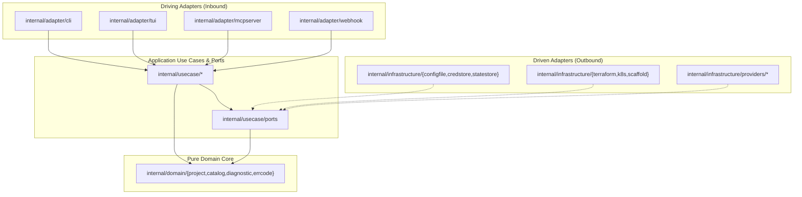

# Hexagonal Architecture (Ports & Adapters)

CAKD Platform follows a strict **Hexagonal Architecture (Ports & Adapters)** enforced continuously by an automated Go AST boundary test (`internal/platform/architecture_test.go`).

## Core Architectural Invariants

1. **Inward-Only Dependency Direction**:
   - `internal/domain/*` imports only Go standard library packages or sibling `internal/domain/*` packages.
   - `internal/usecase/*` depends only on `internal/domain/*`, `internal/usecase/ports`, and `internal/platform/*`.
   - `internal/adapter/*` (Driving) never imports `internal/infrastructure/*` (Driven) directly.
2. **Zero Terminal I/O Coupling in Core Layers**:
   - Interactive credential prompting (`term.ReadPassword`, `os.Stdin`) exists exclusively in `internal/adapter/cli` and `internal/adapter/tui`.
   - Progress reporting uses `progress.Sink` on `context.Context`.
3. **Isolated Terraform State Directories**:
   - Cluster infrastructure state is stored at `out/<project>/.platform/terraform/cluster/`.
   - GitHub VCS repository state is stored at `out/<project>/.platform/terraform/vcs/`.
   - Both stages communicate via `ports.ClusterStateStore` (`~/.cakd/cluster-state.json`).
