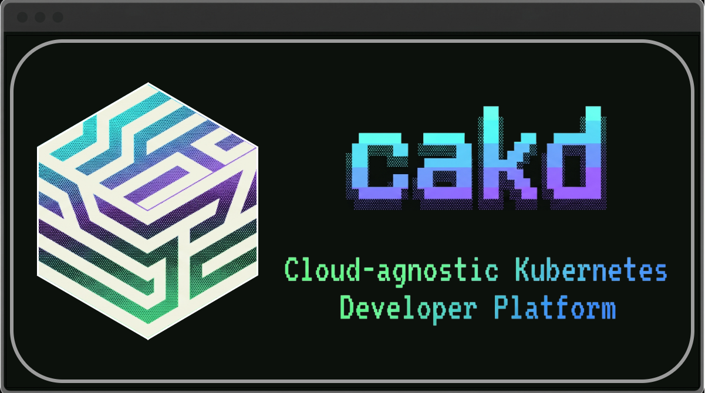

# CAKD Platform

**CAKD (Cloud Application Kubernetes Deployment)** is an open-source Internal Developer Platform (IDP) built in Go 1.27 with a strict **Hexagonal Architecture (Ports & Adapters)**. From a single declarative `platform.yaml` (or an interactive terminal wizard / AI agent tool call), CAKD scaffolds cloud-native microservices, provisions cloud infrastructure via Terraform, sets up GitOps continuous delivery with ArgoCD, and runs AI-powered root-cause diagnostics on Kubernetes workloads.

## Three Driving Surfaces

| Surface | Entrypoint | Target Persona |
| :--- | :--- | :--- |
| **CLI** | `cakd validate \| init \| create \| observe \| auth \| schema` | Developers, DevOps engineers, CI/CD pipelines (`--json`) |
| **Interactive TUI Wizard** | `cakd ui` or `cakd create -i` | Developers who want guided step-by-step project creation without writing YAML |
| **MCP Server** | `cakd mcp` or `cakd-mcp` (Stdio & Streamable HTTP) | AI Coding Assistants (Claude Desktop, Cursor, Antigravity) |

## Quick Navigation

- **[Quickstart Tutorial](tutorials/quickstart.md)** — Bootstrap your first microservice platform in minutes.
- **[Hexagonal Architecture](explanation/architecture.md)** — Understand CAKD's inward-only dependency rules and isolated Terraform state boundaries.
- **[`platform.yaml` Schema Reference](reference/platform-yaml.md)** — Canonical `cakd.io/v1alpha1` specification and defaults.
- **[MCP Tools & Resources](reference/mcp-tools.md)** — Connect AI agents directly to CAKD Platform.
